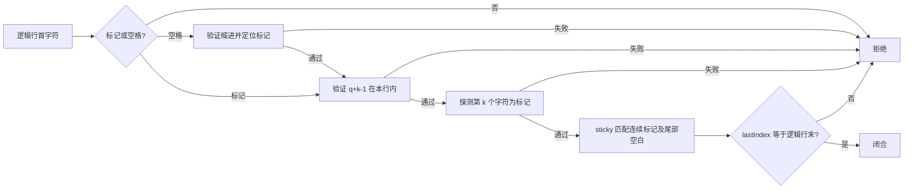

# Fence 路径模型与 V8 实证

2026-11-18，Node **26.13.0** / V8 **14.6.202.34-node.40** / Apple M1 Pro arm64。

> 冻结的第一阶段记录。后续目标已扩展为 fence 总占比约 5%；第一阶段之后已采用经独立八块确认的 opening 改动。下面“保留基线”“源码未改动”仅描述这六个候选的冻结比较，不是最新生产状态。

> 计数勘误：旧脚本在保存 examples 的统计对象后，用同一对象记录了下一次 Rust 文档初始化。下面 examples 行已用独立重跑的 82 次检查更正；原 JSON 中的 338 次记录原样保留。spec、Rust、编辑统计及全部独立吞吐观测不受影响。更正结果与脚本见 [后续研究数据](fence-followup-node26.json)。

本轮保留工作区已有的 sticky 正则实现。实现并比较了六个候选，未找到足以替换基线的稳定吞吐收益。“最速”只能相对于输入分布、运行时和候选集合定义；本轮没有证明所有 JS 程序、所有输入或其他 V8 版本上的全局最优。

基线是开始时的**工作区快照**，包括尚未提交的 `createFenceRule` / sticky matcher，**不是 HEAD 的字符循环实现**。原有源码、暂存区及其他未提交修改均未改动。可运行 JS 在 [scripts/fence-research.mjs](../../../scripts/fence-research.mjs)；[配套 JSON](fence-path-model-node26.json) 保留冻结源码、候选源码、全部 192 次计时观测和 fence 函数反汇编。

## 1. 语义与必须证明的事实

设源字符串为 UTF-16 序列 `s`，逻辑行区间为 `[b,e)`，容器投影遗留列数为 `p`，标记为 `m`，开 fence 长度为 `k`。开头允许至多三列缩进；闭合行在有效标记位置 `q` 后属于语言：

```text
L(m,k) = m^r · {SP,TAB}^w，r >= k，w >= 0
```

`q` 必须来自现有行投影/缩进协议。首字符为标记的路径沿用已有协议；首字符为空格时，允许继续消费的空格数受 `3-p` 限制。不能把物理行首、逻辑行首、TAB 展开后的列混为一个坐标。

开 fence 识别顺序是：标记属于规则 → 数出连续标记 → 达到规则最小长度 → 对禁止在 info 中出现标记的规则检查 info → 记录缩进、标记、长度、位置和共享 matcher。结束标记必须使用实际开 fence 长度 `k`，仅检查 code 的常量 3 或 math 的常量 2 不够。

闭合检查的证明链：



第 `k` 个字符的探测只是**必要条件**。例如 `k=3` 时，标记、空格、标记这三个字符仍能通过首尾探测，必须继续证明中间没有缺口。直接跳过中间字符会误判。精确行末用数值 `lastIndex === e` 验证；不引入会把 U+2028/U+2029 当作换行的多行 `$` 锚点。

对没有预计算摘要的任意字符串，成功识别一般必须验证这段连续标记和尾部空白，字符访问模型下为 Ω(r+w)，固定字宽 W 的批量读取模型下为 Ω((r+w)/W)。减少源码里的 `charCodeAt` 次数不能据此宣称减少了底层比较次数。

## 2. 期望成本和最优策略的定义

在状态 S（已知事实、尚存输入集合）和运行时状态 M（字符串表示、反馈、JIT 层级等）上，有限候选测试集合的最优决策满足：

```text
V(S,M) = min_t { c(t,S,M) + Σ_o P(o | S,M,t) · V(S_o,M_o) }
```

终态代价为 0。若两个拒绝测试在同一状态都合法、固定成本分别为 `cA,cB`、拒绝概率为 `rA,rB`，交换顺序的条件是：

```text
A 在先更优 <=> cA + (1-rA)cB <= cB + (1-rB)cA
             <=> cA/rA <= cB/rB       （rA,rB > 0）
```

缩进、行末、字符加载有依赖，实际成本还受反馈和分支历史影响，不能把这个排序式机械地套在所有 `if` 上。它的用途是提出可检验候选。

以基线闭合路径为例，令 `cF` 表示首字符门禁，`cI` 表示空格缩进分支，`cB` 表示行末/长度边界，`cP` 表示第 k 个字符探测，`cR(r,w)` 表示一次正则调用和实际扫描，`cE` 表示末端相等检查。spec 的一次完整 parse 得到：

```text
Tclose ≈ 4876 cF + 366 cI + 794 cB + 705 cP
         + Σ_705 cR(r_i,w_i) + 705 cE
```

这是按路径计数的成本模型，**没有给这些系数拟合纳秒数**；不是可相加的 CPU 采样百分比。全流程还包含：

```text
Tfence = Topen + Σ Tclose + Tbody + Ttoken/AST
```

`Tbody` 中连续物理行走 slice/换行归一化/缩进替换，投影行走逐行提取和 join；无缩进、无需归一化的 slice 也可能产生共享底层存储的字符串，不能统一按复制 B 个字符计费。本轮不改变这些阶段和增量扫描协议，也不把闭合内核的差异外推为整份文档的同等收益。

### 实测路径分布

| 场景 | 闭合调用 | 首字符拒绝 | 缩进拒绝 | 边界拒绝 | 第 k 字符拒绝 | 正则调用 | 真正闭合 |
|---|---:|---:|---:|---:|---:|---:|---:|
| spec | 4,876 | 3,730 | 352 | 89 | 0 | 705 | 705 |
| 652 examples | 82 | 37 | 11 | 3 | 0 | 31 | 29 |
| Rust | 256 | 129 | 95 | 0 | 0 | 32 | 32 |
| APIs | 0 | 0 | 0 | 0 | 0 | 0 | 0 |
| 破坏 Rust 第一个闭合 fence 的一次编辑 | 172 | 134 | 29 | 0 | 6 | 3 | 2 |
| 恢复该字符的一次编辑 | 32 | 21 | 8 | 0 | 0 | 3 | 3 |

spec 有 **83.72%** 的闭合检查在首字符或缩进阶段终止。794 条候选中，741 条要求长度 32，53 条要求长度 3；实际通过 matcher 的 705 条中有 652 条长度 32。这解释了为何短拒绝路径和长连续标记内核都不能忽略。第 k 字符探测在 spec 上没有额外拒绝，但在实际 fence 编辑中拒绝了 6 条，不能只根据 spec 删除。

开 fence 的 spec 计数为 757 次调用、20,383 次成功的后续标记读取、49 次长度拒绝、708 次 info 检查、5,610 次 info 字符读取，最终接受 708 次。Rust 有 730 次调用，其中 658 次在最小长度处拒绝。对 Rust 提前查询所有 info 行末，会把工作移到大量失败路径上。

这些计数由独立插桩获得，并与未插桩基线比较完整 AST/位置。计数程序不参与吞吐计时。examples 更正值来自完整 652 文档的独立累计。

## 3. 根据机器码提出并筛选 JS 候选

V8 官方文档说明正则存在解释及原生编译层级；本轮直接检查实际生成代码，不从文档推测当前构建的优化结果。[V8 RegExp tier-up](https://v8.dev/blog/regexp-tier-up)、[RegExp 内建实现](https://v8.dev/blog/speeding-up-regular-expressions)。

自然执行 spec 预热 1,600 次，GC 后执行 800 次，再诊断 800 次。诊断使用 `--no-concurrent-recompilation` 使日志可读，另开进程，不拿诊断时间估计吞吐。以下是本次 standalone TurboFan `closesFence` 以及反引号 matcher 的 **Instructions size**，不是热路径指令条数，也不是整个 parser 的代码总量：

| 版本 | 变化 | JS 字节 | RegExp 字节 |
|---|---|---:|---:|
| baseline | 现有提前拒绝 + `m+[ SP TAB ]*` sticky | 5,408 | 1,208 |
| minimum | 把规则最小值写入正则 `{3,}` / `{2,}`，保留动态 k 探测 | 5,408 | 1,256 |
| deferred | 先调用正则，再验证逻辑行末和动态 k | 5,368 | 1,208 |
| bounded | 保留所有提前拒绝，改用有界 JS 标记循环和空白循环 | 8,440 | 未执行 |
| suffix | 复用首标记证明，改用 `m*`，从 `q+1` 匹配 | 5,416 | 1,184 |
| indent | 复用首空格证明，缩进分支直接定位并比较标记一次 | 4,640 | 1,208 |
| lastIndex | 调用 `.test` 后只比较 lastIndex，忽略布尔结果 | 5,392 | 1,208 |

`bounded` 保留原有 descriptor / 规则对象，隔离的是识别内核，不能宣称测量了删除正则对象的分配收益。`lastIndex` 的语义依据是首标记已保证非空匹配；即使 sticky 匹配失败，也会把 lastIndex 重置为 0，而这一候选行的 `e>0`。

baseline 的反引号 matcher 在 spec 的双字节字符串上有如下实际循环（省略绝对地址，保留偏移和指令）：

```asm
a4  tbz  w21, #31, exit
a8  ldrh w22, [x25, w21, sxtw]
ac  cmp  w22, #0x60
b0  b.ne exit
b4  add  w21, w21, #2
b8  b    loop_a4
```

这段循环每个字符增加两个**字节**；不能把它误读成一次处理两个字符或 SIMD。JS `charCodeAt` 的对应反汇编则包含字符串类型/表示分派、间接字符串定位和 one-byte/two-byte 加载分支。`bounded` 的函数明显变大，这与其完整 parse 的回退方向一致，但尚不能将全部回退单独归因于某个检查。

baseline 的 `lineIndentOffset`、`start`、`end`、`prefixColumns` 被内联。`indent` 复用已知首空格，确实减少了重复逻辑并缩小代码；吞吐却没有检出改善。`suffix` 的正则更小而 JS 部分略大。`lastIndex` 少 16 字节，同样不自动构成性能收益。开 fence 的 standalone `fenceAt` 为 4,816 字节，完整反汇编也已保留。

七个版本的最后 800 次诊断阶段均未观察到 bailout；仍各有一个匿名 MAGLEV 编译完成事件。GC 后 settling 阶段还有 bailout/编译，不能据此宣称整个测量协议已经 JIT 静止。另有一份未关闭并发编译的 baseline 探索日志，其正则代码大小为 1,200 字节；完整日志留在本机缓存。这再次说明代码大小受运行和编译上下文影响。

## 4. 完整 parse 的配对测量

每个候选、每个场景使用四个交替 ABBA/BAAB 块，16 个独立进程；六个候选、两个场景，共 **192 个计时进程**。每次 250 ms 预热、full GC、150 ms settling、约 300 ms 自然 GC 计时，`taskpolicy -c utility`，计时进程串行且不与构建、测试、诊断重叠。沿用 `benchmark-abba.ts` 的逐块 log ratio 和 Student-t 95% 区间。以下正数表示更慢。

| 候选 | spec 耗时变化 [95% CI] | examples 耗时变化 [95% CI] |
|---|---:|---:|
| minimum | −0.43% [−1.08%, +0.23%] | −0.29% [−2.40%, +1.87%] |
| deferred | +0.67% [−0.58%, +1.93%] | −0.72% [−2.25%, +0.84%] |
| bounded | +1.20% [+0.03%, +2.39%] | −0.94% [−3.07%, +1.23%] |
| suffix | +0.21% [−0.64%, +1.08%] | +0.69% [−2.09%, +3.55%] |
| indent | +0.64% [−0.20%, +1.47%] | −0.38% [−1.57%, +0.83%] |
| lastIndex | −1.13% [−4.49%, +2.36%] | −0.04% [−0.73%, +0.66%] |

没有删除不利块，也没有根据结果反复重测直到有利。所有收益区间跨零；`bounded` 的 spec 是本轮未做多重比较校正的边际回退证据。保留基线不等于已证明其他候选和它等速，也不等于证明基线在所有分布上最快。本轮没有新的 Rust/API/增量吞吐、独立 fence 微基准或 remark 倍数结论。

若用 `Tjs(r)=ajs+bjs·r` 与 `Trx(r)=arx+brx·r` 表示短运行和长运行的两类内核，理论交点为 `(arx-ajs)/(bjs-brx)`。本轮没有估计这些独立系数，不能从 spec 的长度 32 峰值发明一个切换阈值写进生产。

## 5. 验证、复现和处置

每个候选在 generated 和强制 CSP 后端**分别**通过 6,088 份文档、6,912 次增量编辑的完整 AST/位置对比；编辑后另与 candidate 的 fresh parse 比较。覆盖四份标准语料的 LF/CR/CRLF/混合结尾，code/math 标记，2/3/4/8/32/257 长度，缩进、容器前缀、空白后缀、非法中间缺口、Unicode 分隔符、NUL 和标记增删。它证明与当前基线一致，不把继承的语法偏差认定为 CommonMark 正确。当前源码的 199 个测试、typecheck 通过，新增 JS 的 syntax check 和 lint 通过。

复现时明确选用 Node 26；普通 shell 的 `node` 在本机指向 Node 24。以下以 `node` 已切换为 Node 26 为前提。这组旧命令需要先将本报告 JSON 中的 `harness` 保存为 `scripts/fence-first-stage.mjs`，并相应替换以下命令的脚本路径；当前工作区脚本已改为快照回放，接口见后续报告。旧 `count` 路径另须在 Rust 文档初始化前重置统计对象，避免上述污染：

```sh
node scripts/fence-research.mjs prepare node_modules/.cache/fence-reproduce
node scripts/fence-research.mjs count node_modules/.cache/fence-reproduce
node scripts/fence-research.mjs validate node_modules/.cache/fence-reproduce
node --disallow-code-generation-from-strings scripts/fence-research.mjs validate node_modules/.cache/fence-reproduce
taskpolicy -c utility node --expose-gc scripts/benchmark-abba.ts node_modules/.cache/fence-reproduce/baseline/index.mjs node_modules/.cache/fence-reproduce/bounded/index.mjs node_modules/.cache/fence-reproduce/bounded-abba.json --cases commonmark/spec,commonmark/examples --blocks 4
node --expose-gc --no-concurrent-recompilation --trace-opt --trace-deopt --trace-turbo-inlining --print-opt-code --print-opt-code-filter=closesFence --print-regexp-code scripts/fence-research.mjs diagnose node_modules/.cache/fence-reproduce bounded
```

`prepare` 首次冻结当前源码，之后读取该目录里的 `sources.json`。要复现**本报告的旧快照**，先从配套 JSON 的 `sources` 字段写出该文件，再执行 prepare；不能用后来变化的源码替代。对每个候选保存对应 `*-abba.json` 和 `jit-sync-*.log`，开头函数日志存为 `jit-opening.log`（filter 改为 `fenceAt`），最后运行 `summarize` 校验 bundle 哈希并汇总。

原始构建、完整 V8 trace 和探索日志在本机 `node_modules/.cache/fence-strategy-20261118/`。配套 JSON 独立保留基线完整源码、六份候选源码、JS harness、构建/输入哈希、所有计时观测、验证计数、完整 fence 优化代码和反引号 regexp 代码；未把所有导入依赖的 trace 冒充为已归档内容。机器码判断和配对测量共同支持的处置是：继续保留现有提前拒绝 + sticky 原生循环；六个候选只作为研究实现，不修改生产解析器。
